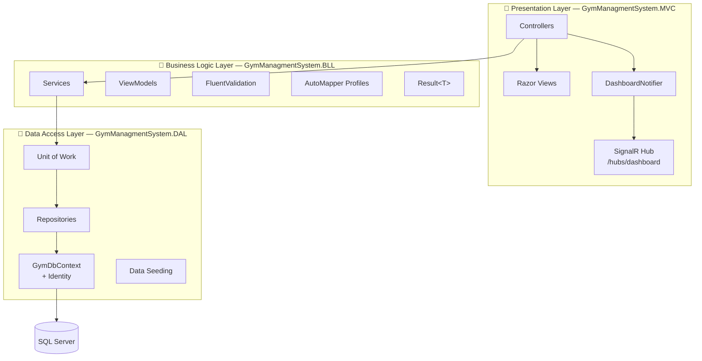
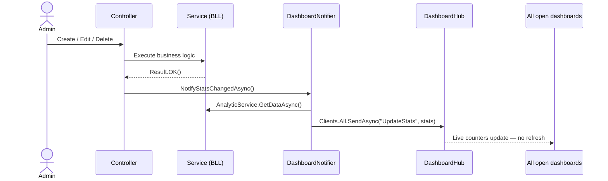
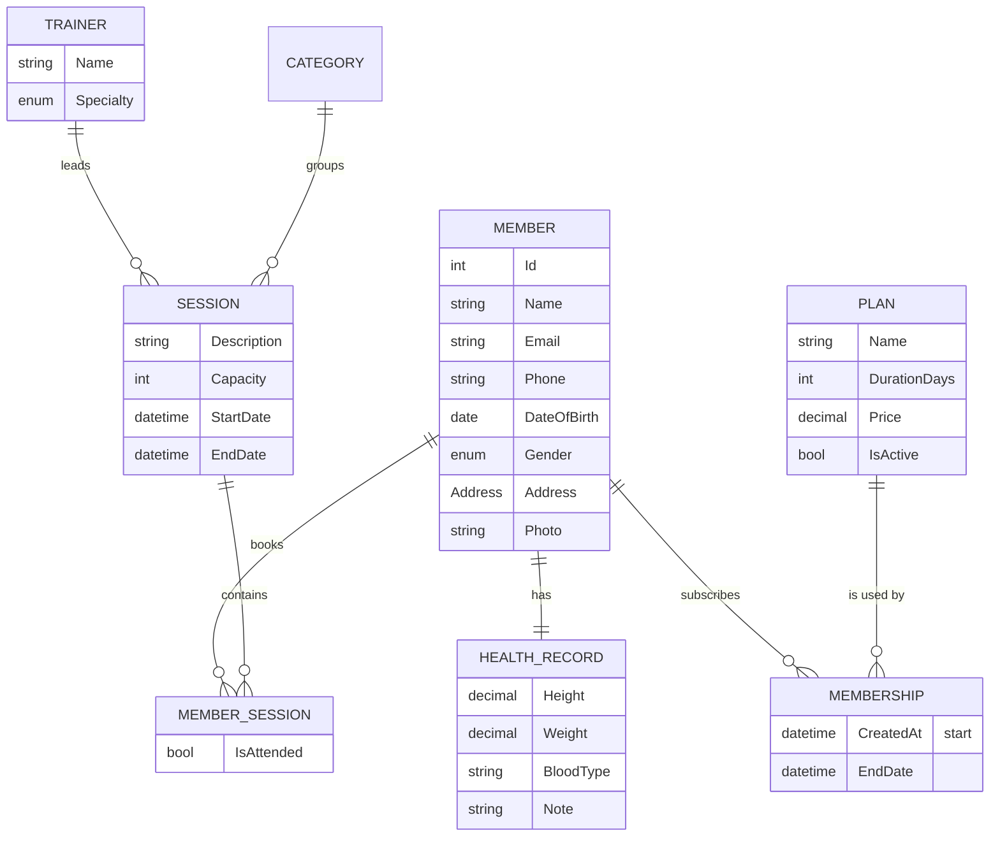

<div align="center">

# 🏋️ Gym Management System

**A full-featured gym administration platform built with ASP.NET Core MVC on .NET 9 —
members, memberships, trainers, sessions, bookings & attendance, with a live SignalR dashboard.**

[](https://dotnet.microsoft.com/download/dotnet/9.0)
[](https://learn.microsoft.com/dotnet/csharp/)
[](https://learn.microsoft.com/aspnet/core/mvc/overview)
[](https://learn.microsoft.com/ef/core/)
[](https://www.microsoft.com/sql-server)
[](https://learn.microsoft.com/aspnet/core/signalr/introduction)
[](https://serilog.net)
[](LICENSE)

[Features](#-features) •
[Architecture](#%EF%B8%8F-architecture) •
[Domain Model](#-domain-model) •
[Business Rules](#-business-rules) •
[Getting Started](#-getting-started) •
[Roadmap](#%EF%B8%8F-roadmap)

</div>

---

## 📖 Overview

**Gym Management System** helps gym owners and staff run day-to-day operations from one place: registering members with photos and health records, selling membership plans, managing trainers, scheduling sessions, booking members into sessions, and tracking attendance.

Every change made in the system — a new member, a cancelled membership, a booked session — is **pushed instantly to every open dashboard via SignalR**, so the numbers on screen are always current without refreshing the page.

Under the hood, the solution is organized into a clean **3-layer architecture** with the **Repository + Unit of Work** patterns, **AutoMapper**, **FluentValidation**, a unified **`Result<T>`** pattern for error handling, **ASP.NET Core Identity** with role-based authorization, and **Serilog** structured logging split by severity.

---

## ✨ Features

### 🧩 Core Modules

| Module | What you can do |
|---|---|
| 🔐 **Authentication** | Sign in with email & password (ASP.NET Core Identity), *Remember me*, logout, and an *Access Denied* page. |
| 👥 **Members** | Create, view, edit, and delete members — with a profile **photo upload**, address, and a dedicated **health record** (height, weight, blood type, notes). |
| 💳 **Plans** | View and edit membership plans, and **activate / deactivate** them (soft delete). Four plans are seeded on first run. |
| 🎫 **Memberships** | Subscribe a member to an active plan; the end date is calculated automatically from the plan duration. Cancel active memberships. |
| 🧑‍🏫 **Trainers** | Full CRUD for trainers with a specialty: *General Fitness, Yoga, Boxing, CrossFit*. |
| 📅 **Sessions** | Schedule sessions with a trainer, category, capacity, and start / end time. |
| 🗓️ **Schedule & Booking** | Book members into upcoming sessions, see available slots, cancel bookings, and **mark attendance** for ongoing sessions. |
| 📊 **Analytics Dashboard** | Total & active members, total trainers, and upcoming / ongoing / completed sessions. |

### ⚙️ Technical Highlights

- ⚡ **Real-time dashboard** — a SignalR hub broadcasts updated statistics after every create / update / delete.
- 🛡️ **Role-based authorization** — `SuperAdmin` and `Admin` roles; the Members module is restricted to `SuperAdmin`.
- ✅ **Two-sided validation** — FluentValidation rules run on the server and are mirrored on the client.
- 📝 **Structured logging** — Serilog writes Info, Warning, and Error events to separate daily-rolling files.
- 🌱 **Auto migrate & seed** — pending migrations are applied and plans, categories, roles, and admin users are seeded on startup.
- 🧱 **Clean code patterns** — Generic Repository, Unit of Work, `Result<T>`, AutoMapper profiles, and convention-based DI registration with **Scrutor**.
- 🖼️ **Safe file uploads** — images only (`.png`, `.jpg`, `.jpeg`, `.gif`), max **5 MB**, stored with GUID file names outside `wwwroot`.

---

## 🏗️ Architecture

The solution follows a **3-layer architecture**. Each layer only depends on the layer directly below it.



| Layer | Project | Responsibility |
|---|---|---|
| **Presentation** | `GymManagmentSystem.MVC` | Controllers, Razor views, SignalR hub, Serilog setup, static assets |
| **Business Logic** | `GymManagmentSystem.BLL` | Services, business rules, ViewModels, validators, mapping, `Result<T>` |
| **Data Access** | `GymManagmentSystem.DAL` | Entities, `DbContext`, Fluent API configurations, repositories, Unit of Work, migrations, seeding |

### ⚡ Real-Time Flow (SignalR)



---

## 🗃️ Domain Model



> `Member` and `Trainer` both inherit from an abstract `GymUser` (name, email, phone, birth date, gender, owned `Address`), and every entity inherits `BaseEntity` (`Id`, `CreatedAt`, `UpdatedAt`).

---

## 📏 Business Rules

The BLL enforces real gym rules — not just CRUD:

| Area | Rule |
|---|---|
| **Members & Trainers** | Email and phone number must be unique. Phone must be a valid Egyptian mobile number. |
| **Memberships** | Only **active** plans can be sold. A member can hold **only one active membership** at a time. End date = start date + plan duration. |
| **Plans** | A plan **cannot be edited while it has active memberships**. Plans are deactivated instead of deleted. |
| **Sessions** | Start date must be in the future, end date after start, capacity between 0 and 25. The trainer's **specialty must match the session category**. Sessions that already started can't be edited. A trainer can't be double-booked in the same time slot. |
| **Bookings** | Members can only book sessions that **haven't started**, must have an **active membership**, can't book the same session twice, and can't exceed session **capacity**. Bookings can't be cancelled after the session starts. |
| **Attendance** | Attendance is marked per member for ongoing sessions. |
| **Uploads** | Images only, max 5 MB, stored under a random GUID file name. |

---

## 🛠️ Tech Stack

| Category | Technology |
|---|---|
| Framework | ASP.NET Core MVC · .NET 9 |
| Language | C# |
| ORM / Database | Entity Framework Core 9 · SQL Server |
| Auth | ASP.NET Core Identity (roles: `SuperAdmin`, `Admin`) |
| Real-time | ASP.NET Core SignalR · `@microsoft/signalr` (via LibMan) |
| Validation | FluentValidation (server + client adapters) |
| Mapping | AutoMapper |
| DI Scanning | Scrutor |
| Logging | Serilog (rolling file sinks) |
| Frontend | Razor Views · HTML · CSS · JavaScript · Bootstrap |

---

## 📁 Project Structure

```
GymManagmentSystem/
├── GymManagmentSystem.DAL/                 # 💾 Data Access Layer
│   ├── Models/                             # Entities + Enums (Gender, Specialty)
│   ├── Contexts/GymDbContext.cs            # IdentityDbContext
│   ├── Data/Configurations/                # Fluent API configurations
│   ├── Data/Migrations/                    # EF Core migrations
│   ├── Repositories/                       # Generic + specific repos, Unit of Work
│   ├── DataSeed/                           # Plan & Identity seeding
│   └── Extentions/DependencyEnjection/     # AddDataAccessLayer()
│
├── GymManagmentSystem.BLL/                 # 🧠 Business Logic Layer
│   ├── Common/                             # Result, Result<T>, ResultKind
│   ├── Services/
│   │   ├── Members/  Trainers/  Plans/  MemberShips/
│   │   ├── Sessions/  Booking/  Analytics/  Attachment/  Accounut/
│   │   └── */{Classes,Interfaces,ViewModel,Validators,Mapping}
│   └── Extentions/DependencyEnjection/     # AddBusinessLogicLayer()
│
├── GymManagmentSystem.MVC/                 # 🎨 Presentation Layer
│   ├── Controllers/                        # Account, Home, Members, Plans, Memberships,
│   │                                       # Trainers, Sessions, Schedule
│   ├── Views/                              # Razor views per controller
│   ├── Hubs/                               # DashboardHub + DashboardNotifier
│   ├── Extentions/                         # Migrate & seed, Serilog setup
│   ├── wwwroot/SeedData/PlanModel/         # plans.json
│   ├── MemberPhotos/                       # Uploaded member photos
│   └── Program.cs
│
├── GymManagmentSystem.slnx
└── LICENSE
```

---

## 🚀 Getting Started

### Prerequisites

- [.NET 9 SDK](https://dotnet.microsoft.com/download/dotnet/9.0)
- [SQL Server](https://www.microsoft.com/sql-server) (Express, Developer, or LocalDB)
- Visual Studio 2022 (17.13+) or VS Code with the C# Dev Kit
- *(Optional)* EF Core CLI: `dotnet tool install --global dotnet-ef`

### Installation

**1. Clone the repository**

```bash
git clone https://github.com/naiw991uen-collab/GymManagmentSystem.git
cd GymManagmentSystem
```

**2. Configure the connection string** in `GymManagmentSystem.MVC/appsettings.json` to point to your SQL Server instance:

```json
"ConnectionStrings": {
  "DefaultConnection": "Server=.\\SQLEXPRESS;Database=GymManagmentsDb;Trusted_Connection=True;TrustServerCertificate=True"
}
```

> Using LocalDB? Use `Server=(localdb)\\MSSQLLocalDB;...` instead.

**3. Restore client libraries** (SignalR JS client via LibMan)

```bash
dotnet tool install -g Microsoft.Web.LibraryManager.Cli
cd GymManagmentSystem.MVC && libman restore && cd ..
```

**4. Run the application**

```bash
dotnet run --project GymManagmentSystem.MVC --launch-profile https
```

On first run the app **automatically applies all migrations and seeds the database** — no manual `dotnet ef database update` needed.

**5. Open** 👉 **https://localhost:7061** (or http://localhost:5198)

### 🔑 Default Accounts

Seeded automatically for local development:

| Role | Email | Password |
|---|---|---|
| SuperAdmin | `NasrMohamed@gmail.com` | `P@ssw0rd` |
| Admin | `ZeadSherif@gmail.com` | `P@ssw0rd` |

> ⚠️ Change these credentials before deploying anywhere public.

### 🌱 Seeded Plans

| Plan | Duration | Price |
|---|---|---|
| Basic Plan | 30 days | 300 |
| Standard Plan | 60 days | 500 |
| Premium Plan | 90 days | 900 |
| Annual Plan | 365 days | 3000 |

---

## 📝 Logging

Serilog splits logs by severity into separate folders, with a **new file every day**:

| Path | Level | Examples |
|---|---|---|
| `Logs/Success/success-YYYYMMDD.txt` | ✅ Information | Successful login, member created, booking confirmed |
| `Logs/Warnings/warning-YYYYMMDD.txt` | ⚠️ Warning | Wrong password, duplicate email, session full, invalid upload |
| `Logs/Errors/error-YYYYMMDD.txt` | ❌ Error & Fatal | Unhandled exceptions, failed database saves |

Framework noise from `Microsoft.*` and `System.*` is filtered down to Warning and above.

---

## 🗺️ Roadmap

- [x] 3-layer architecture with Repository & Unit of Work
- [x] Identity authentication with roles
- [x] Members with photos & health records
- [x] Plans & memberships
- [x] Trainers & sessions
- [x] Session booking & attendance tracking
- [x] Analytics dashboard with real-time SignalR updates
- [x] Serilog logging split by severity
- [ ] Enable account lockout on failed logins (`lockoutOnFailure: true`)
- [ ] Admin user management UI (create admins, assign roles)
- [ ] Payment history and invoices
- [ ] Email notifications for expiring memberships
- [ ] Search, filtering & pagination on list pages
- [ ] Unit & integration tests
- [ ] Docker support & CI pipeline

---

## 🤝 Contributing

Contributions are welcome!

1. Fork the project
2. Create a feature branch: `git checkout -b feature/your-feature`
3. Commit your changes: `git commit -m "Add your feature"`
4. Push the branch: `git push origin feature/your-feature`
5. Open a Pull Request

---

## 📄 License

This project is licensed under the [MIT License](LICENSE).

## 👤 Author

**Nasr Mohamed** — [@naiw991uen-collab](https://github.com/naiw991uen-collab)

---

<div align="center">

⭐ If you find this project useful, please give it a star!

</div>
